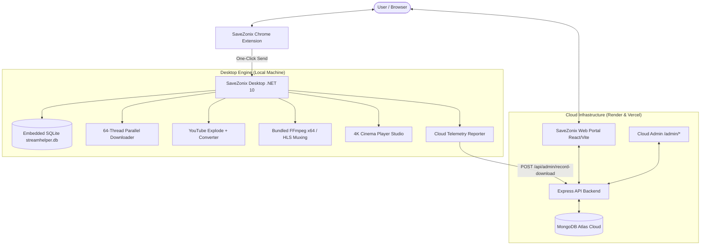

# SaveZonix — High-Performance Media Downloader & Playback Platform

<div align="center">


**The Ultimate All-in-One 64-Thread Download Accelerator, HLS Stream Recorder, 4K Cinema Studio & Cloud Admin Platform**

[](#)
[](#)
[](#)
[](#)
[](#)
[](#)
[](#)
[](#)
[](#)

</div>

---

## 🌐 Live Deployments

| Component | Service | URL |
| :--- | :--- | :--- |
| **Official Web Portal** | Vercel | [https://save-zonix.vercel.app](https://save-zonix.vercel.app) |
| **Super Admin Control Center** | Vercel | [https://save-zonix.vercel.app/admin/overview](https://save-zonix.vercel.app/admin/overview) |
| **Cloud API & Telemetry Engine** | Render | [https://savezonix.onrender.com](https://savezonix.onrender.com) |
| **Desktop App Installer** | Windows x64 | Built via `build-installer.bat` (v2.5.2) |

---

## 📑 Table of Contents

1. [Overview & Core Architecture](#-overview--core-architecture)
2. [Repository Structure](#-repository-structure)
3. [Key Features & Modules](#-key-features--modules)
   - [Desktop App (.NET 10 Win-x64)](#1-desktop-engine--app-savezonix-app)
   - [Super Admin Control Center (Web Cloud)](#2-super-admin-control-center-savezonix-webclient)
   - [Cloud Telemetry & API Server](#3-cloud-telemetry--backend-savezonix-webserver)
   - [Chrome Extension (MV3)](#4-chrome-extension-mv3)
   - [Production Inno Setup Installer](#5-production-installer-pipeline)
4. [Quick Start & Setup Guide](#-quick-start--setup-guide)
   - [Prerequisites](#prerequisites)
   - [Running Desktop App](#1-running-the-desktop-application)
   - [Running Web Portal & Admin](#2-running-web-client)
   - [Running Cloud Server](#3-running-cloud-server)
   - [Loading Chrome Extension](#4-loading-the-chrome-extension)
   - [Building 1-Click Windows Setup EXE](#5-building-the-production-installer)
5. [API Reference](#-api-reference)
6. [Environment Variables](#-environment-variables)
7. [What's New in v2.5.2](#-whats-new-in-v252)
8. [License](#-license)

---

## 🌟 Overview & Core Architecture

**SaveZonix** is a high-performance media acquisition and entertainment ecosystem designed for creators and archival research. It integrates a high-speed desktop download engine, an HLS live stream capture system, an integrated 4K Cinema Studio player, a browser extension for instant video sniffing, and a centralized web-based control center with real-time analytics.



---

## 📂 Repository Structure

```
SaveZonix/
├── build-installer.bat          # 1-Click automated compile & installer generator
├── README.md                    # Unified Monorepo Documentation
│
├── SaveZonix-App/               # Desktop Application (.NET 10 Web / Win-x64)
│   ├── Controllers/             # MVC Controllers (Home, Account, Cinema, Playlist, Legal)
│   ├── Core/                    # Media engines, stream slicer, ParallelDownloader
│   ├── Data/                    # AppDbContext (SQLite) & DbSeeder (Clean 0-fake seed)
│   ├── Extension/               # Chrome Extension (Manifest V3)
│   ├── Models/                  # Data models and view-models
│   ├── Services/                # YouTube, PlaylistQueue, CloudSettingsSync, FFmpeg services
│   ├── Views/                   # Razor views & unified 4-column _Layout.cshtml
│   ├── wwwroot/                 # Desktop UI (HTML5/CSS3/JS, themes, assets, app.ico)
│   │   ├── assets/logo.png      # Official SaveZonix vector logo
│   │   ├── app.ico              # Multi-resolution Windows app & installer icon
│   │   ├── app.js               # Download controller & telemetry push client
│   │   ├── playlist.js          # Studio batch playlist manager
│   │   └── active-downloads-monitor.js
│   ├── installer/               # Inno Setup 6 configuration
│   │   └── installer.iss        # Setup installer script (v2.5.2)
│   ├── Program.cs               # App startup, core REST APIs, background workers
│   └── Zonix.csproj             # .NET 10 project file (SQLite, bundled FFmpeg, WinExe)
│
└── SaveZonix-Web/               # Web Application & Cloud API (MERN Stack)
    ├── client/                  # React + Vite Frontend (Deployed to Vercel)
    │   ├── src/
    │   │   ├── components/      # UI components (Hero, Features, Pricing, Footer, LegalPage)
    │   │   │   ├── AdminDashboard.jsx # Super Admin Dashboard (Unified Auth, Sub-routed)
    │   │   │   └── admin/       # Dedicated sub-tab views (Overview, Users, Downloads, etc.)
    │   │   ├── App.jsx          # Route definitions (/, /admin/:tabId, /privacy, /terms)
    │   │   └── main.jsx         # Entry point
    │   ├── package.json
    │   └── vite.config.js
    │
    └── server/                  # Node.js + Express Cloud Backend (Deployed to Render)
        ├── models/              # Mongoose schemas (User, DownloadHistory, AppConfig)
        ├── routes/              # Express route handlers (auth, admin, telemetry)
        │   ├── admin.js         # Admin endpoints + telemetry receiver
        │   ├── auth.js          # JWT & Google OAuth routes
        │   └── appConfig.js     # Desktop client remote configuration
        ├── seeds/               # seedDatabase.js (Clean 0-fake history seeder)
        ├── package.json
        └── index.js             # Express app entry & MongoDB Atlas connection
```

---

## ⚡ Key Features & Modules

### 1. Desktop Engine & App (`SaveZonix-App`)
* **Embedded SQLite Local Storage (`streamhelper.db`):** Completely replaced heavyweight SQL Server dependencies with fast, zero-configuration embedded SQLite with WAL (Write-Ahead Logging).
* **Decoupled Admin Responsibilities:** All administrative controls are centralized strictly on the Web Cloud portal ([https://save-zonix.vercel.app/admin/overview](https://save-zonix.vercel.app/admin/overview)), freeing the desktop app to focus on pure media download and playback speed.
* **Unified 4-Column Layout:** Matching footer layout with emerald `All Systems Operational` badge, Product & Engine links, Legal & Policy links, and direct link to `🛡️ Cloud Admin`.
* **64-Thread Dynamic Slicing:** Splits files into up to 64 concurrent byte-range HTTP streams for maximum bandwidth saturation.
* **YouTube Single & Playlist Studio:**
  * Auto-detects all available resolutions: 1080p, 1440p 2K, 2160p 4K, 4320p 8K at 60fps with HDR.
  * Audio extraction with direct 320kbps MP3 / AAC muxing via multi-directory detected bundled FFmpeg.
  * Multi-video playlist batch downloader with progress tracking and pause/resume.
* **HLS / M3U8 Live Stream Capturer:** Live stream recording engine capturing segmented `.m3u8` playlists into lossless `.mp4` containers.
* **4K Cinema Studio:** Embedded theater mode player supporting hardware acceleration, picture-in-picture, audio boost, and frame-accurate seeking.

### 2. Super Admin Control Center (`SaveZonix-Web/client`)
* **Unified Single Sign-In:** No separate admin login form; uses the main user login token (`savezonix_token`), automatically granting full admin access to users with `role: 'Admin'` or `zaidm1323@gmail.com`.
* **Separate Dedicated Routes:**
  * `/admin/overview` — Live KPIs, active downloads, system health, bandwidth graphs.
  * `/admin/users` — User management, subscription tiers, usage quotas.
  * `/admin/downloads` — Live telemetry history of downloads performed across desktop apps worldwide.
  * `/admin/ai-cdn-advisor` — Real-time CDN probing and concurrency calibration.
  * `/admin/diagnostics` — Node runtime, memory heap, and database query latency.
  * `/admin/security` — Security event log, API rate limits, blocked IP controls.
  * `/admin/engine-database` — Remote download engine configuration and MongoDB Atlas fleet status.
* **Micro-Progress Lazy Loading:** Fast UI switches with progress indicator and per-tab state caching.

### 3. Cloud Telemetry & Backend (`SaveZonix-Web/server`)
* **Public Telemetry Endpoint (`POST /api/admin/record-download`):** Desktop apps automatically report completed and failed download metrics to MongoDB Atlas in real time.
* **Remote App Config (`GET /api/app-config`):** Centralized remote configuration distribution for all desktop client instances.
* **Clean 0-Fake Seed:** Fresh database installations start completely clean with zero fake dummy records.

### 4. Chrome Extension (MV3)
* **Automatic Media Sniffer:** Detects active video and audio streams across 50+ sites.
* **One-Click Send:** Sends video URLs directly to the local desktop app (`http://localhost:5000`) for immediate high-speed acceleration.

### 5. Production Installer Pipeline
* **Custom Inno Setup 6 Script:** Generates an enterprise-ready single-file setup installer (`SaveZonix-Setup-v2.5.2.exe`).
* **Official Branding:** Real site logo embedded into the installer executable, the app shortcut, and the Windows "Installed Apps" list.
* **Anti-Lock Compilation:** Compiles within an isolated temp directory to prevent Antivirus `EndUpdateResource` file-locking (Win32 Error 110).

---

## 🚀 Quick Start & Setup Guide

### Prerequisites
* Windows 10 / 11 (64-bit)
* [.NET 10.0 SDK](https://dotnet.microsoft.com/download)
* [Node.js 18+](https://nodejs.org) and npm
* [Inno Setup 6](https://jrsoftware.org/isdl.php) (only needed if compiling installer)
* MongoDB instance (local or [MongoDB Atlas](https://www.mongodb.com/atlas))

---

### 1. Running the Desktop Application

```powershell
cd "SaveZonix-App"
dotnet restore
dotnet run
```
The desktop app interface will launch and be accessible at:
👉 **`http://localhost:5000`**

---

### 2. Running Web Client

```powershell
cd "SaveZonix-Web\client"
npm install
npm run dev
```
The web portal will start at:
👉 **`http://localhost:5173`**
👉 Super Admin Panel: **`http://localhost:5173/admin`**

---

### 3. Running Cloud Server

```powershell
cd "SaveZonix-Web\server"
npm install
# Set environment variables in .env (see section below)
npm start
```
The API server will run at:
👉 **`http://localhost:5001`**

---

### 4. Loading the Chrome Extension

1. Open Google Chrome and navigate to `chrome://extensions/`.
2. Toggle on **Developer mode** in the top-right corner.
3. Click **Load unpacked**.
4. Select the directory: `SaveZonix-App/Extension`.

---

### 5. Building the Production Installer

To produce the production-ready Windows setup executable with 1 click:

1. Double-click **`build-installer.bat`** in the repository root (or run it from terminal):
   ```cmd
   build-installer.bat
   ```
2. The script will:
   - Compile `Zonix.csproj` into a self-contained Release build (`win-x64`).
   - Run Inno Setup 6 with isolated temp output to prevent antivirus lockouts.
   - Embed the official `app.ico` into the installer and Windows registry.
   - Place the output executable into:
     📁 `SaveZonix-App\installer\SaveZonix-Setup-v2.5.2.exe`

---

## 📡 API Reference

### Cloud Server Endpoints (`SaveZonix-Web/server`)

| Method | Endpoint | Description | Auth |
| :--- | :--- | :--- | :--- |
| `POST` | `/api/admin/record-download` | Records download telemetry from desktop apps | Public |
| `GET` | `/api/admin/download-history` | Fetches aggregated download history | Admin |
| `GET` | `/api/admin/stats` | Fetches server KPIs, active users, storage metrics | Admin |
| `GET` | `/api/admin/users` | Lists registered accounts with subscription tiers | Admin |
| `GET` | `/api/admin/probe-cdn` | Probes CDN edge response and recommends thread caps | Admin |
| `GET` | `/api/admin/database-status` | Reports MongoDB Atlas cluster & SQLite engine state | Admin |
| `GET` | `/api/app-config` | Delivers remote configuration to desktop apps | Public |
| `POST` | `/api/auth/register` | User account registration | Public |
| `POST` | `/api/auth/login` | User login (returns JWT) | Public |

### Desktop App Local Endpoints (`SaveZonix-App`)

| Method | Endpoint | Description |
| :--- | :--- | :--- |
| `POST` | `/api/analyze` | Analyzes video/stream URL and extracts downloadable streams |
| `POST` | `/api/download` | Starts single file / multi-threaded stream download |
| `POST` | `/api/playlist/analyze` | Parses YouTube playlist URL and returns item metadata |
| `POST` | `/api/playlist/start-batch` | Starts batch playlist download queue |
| `GET` | `/api/playlist/status` | Returns real-time progress for active batch job |
| `POST` | `/api/playlist/cancel` | Cancels current playlist job gracefully |
| `GET` | `/api/active-jobs` | Returns telemetry for all running background downloads |
| `GET` | `/api/system/health` | Diagnostic health check returning engine status & version |

---

## 🔐 Environment Variables

Create a `.env` file in `SaveZonix-Web/server/`:

```env
PORT=5001
MONGODB_URI=mongodb+srv://<username>:<password>@cluster.mongodb.net/savezonix?retryWrites=true&w=majority
JWT_SECRET=your_super_secure_jwt_secret_key_2026
ADMIN_KEY=savezonix_admin_2026
CLIENT_URL=https://save-zonix.vercel.app
```

---

## 🆕 What's New in v2.5.2

* **Complete SQL Server Retirement & Embedded SQLite Migration:**
  * Removed `Microsoft.EntityFrameworkCore.SqlServer` and dual-DB sync service in favor of zero-overhead, fast embedded SQLite (`streamhelper.db`) with WAL mode.
* **Centralized Web Cloud Admin & Desktop Decoupling:**
  * Removed desktop admin endpoints from `Program.cs`. All administration is strictly handled via [https://save-zonix.vercel.app/admin/overview](https://save-zonix.vercel.app/admin/overview).
  * Desktop app reports download telemetry directly to the cloud API (`POST /api/admin/record-download`).
* **Strict Admin Link Stealth in Footers:**
  * Completely removed all admin login / admin access links from public footers on both desktop and web apps for enhanced operational security.
* **Unified Single Sign-In for Admin:**
  * Unified user and admin authentication into a single modal. Admins log in once and receive immediate access across all `/admin/*` routes.
* **Separate Direct Admin Sub-Routes:**
  * Clean dedicated sub-routes for `/admin/overview`, `/admin/users`, `/admin/downloads`, `/admin/ai-cdn-advisor`, `/admin/diagnostics`, `/admin/security`, and `/admin/engine-database`.
* **Zero-Fake Database Seeder:**
  * Purged all hardcoded sample downloads from both `.NET` and MERN seed scripts. Clean start with 0 fake history records.
* **Synchronized 4-Column Footers:**
  * Matching 4-column footer design across desktop and web with emerald `All Systems Operational` badge, Product & Engine links, Resources & Docs, and Legal & Policy trust links.
* **FFmpeg Multi-Path Resolution & Audio/Video Muxing:**
  * Fixed video+audio stream muxing issues with multi-directory binary resolution.

---

## 📄 License

Proprietary Software. All rights reserved.  
Copyright © 2026 SaveZonix Inc.

