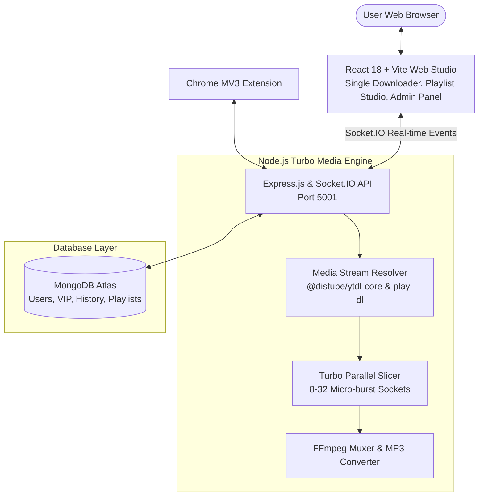
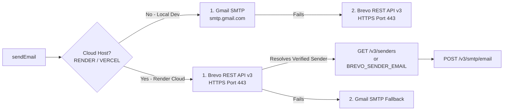

# 🚀 SaveZonix — Universal High-Performance Media Downloader Suite

Universal commercial-grade media download ecosystem built with **100% MERN Stack (MongoDB Atlas, Express.js, React.js, Node.js)** and **Chrome Extension (Manifest V3)**.

---

## 🌐 Deployments

| Component | Host | URL |
| :--- | :--- | :--- |
| **Web Portal & Studio** | Vercel | [https://savezonix-pro.vercel.app](https://savezonix-pro.vercel.app) |
| **Admin Dashboard** | Vercel | [https://savezonix-pro.vercel.app/admin/overview](https://savezonix-pro.vercel.app/admin/overview) |
| **Backend API** | Render / Local | [https://savezonix.onrender.com](https://savezonix.onrender.com) (or `http://localhost:5001`) |
| **Chrome Extension** | Chrome Web Store / Unpacked | `extension/` directory |

---

## 🏗️ Clean MERN Architecture



---

## 📁 Repository Structure

```
SaveZonix/
├── client/              # React 18 + Vite Frontend (Landing, DownloadStudio, Admin)
│   ├── src/
│   │   ├── components/  # DownloadStudio, AdminDashboard, Navbar, etc.
│   │   ├── App.jsx
│   │   └── main.jsx
│   └── package.json
│
├── server/              # Node.js + Express + Socket.IO Backend
│   ├── controllers/     # downloadController, playlistController, adminController
│   ├── models/          # User, DownloadHistory, PlaylistQueue, AppConfig
│   ├── routes/          # downloads, playlist, auth, admin, payment
│   ├── services/        # TurboDownloader, MediaResolver, FFmpegService
│   ├── server.js        # Main Express server with Socket.IO
│   └── package.json
│
├── extension/           # Chrome Extension (Manifest V3)
│   ├── manifest.json
│   ├── src/             # popup, content script, background service worker
│   └── icons/
│
├── branding/            # Logos, banners, visual assets
├── vercel.json          # Vercel deployment configuration
└── package.json         # Unified Monorepo Workspaces Configuration
```

---

## ⚡ Quick Start

### 1. Install All Dependencies
```bash
npm run install:all
```

### 2. Run Both Server & React Client Concurrently
```bash
npm run dev
```

### 3. Run Server Only (Production Mode)
```bash
npm run server
```
* Access Web Portal at: `http://localhost:5001` (or `http://localhost:5173` in Vite dev mode).
* Real-time Socket.IO streams live progress on `http://localhost:5001/socket.io`.

---

## 🛡️ Security & Performance Highlights
* **Zero-RAM Slicing:** Micro-burst parallel range downloads directly to disk with dynamic chunking.
* **100% Cloud Persistence:** MongoDB Atlas automatically tracks history, users, and VIP payment tiers.
* **Direct Web Downloading:** Users can download media directly in their browser without installing any desktop software or unzipping files.

---

## 📧 Step-by-Step: How OTP Verification & Email Delivery Works

SaveZonix supports both **6-digit OTP verification** and **1-Click Magic Links** for account registration and password resets across local development and cloud production.

### 1. Frontend Request (`client/src/components/AuthModal.jsx`)
1. When a user requests an OTP:
   - **Sign Up**: Submits `POST /api/auth/send-register-otp` with `{ name, email, password }`.
   - **Forgot Password**: Submits `POST /api/auth/send-reset-otp` with `{ email }`.
2. Immediately on submission, the UI disables the submit/send button, waits for the API response, displays the status banner, and activates a **60-second resend cooldown** timer.
3. For 1-Click Magic Links, URL query parameters (`verify_email`/`verify_token` or `reset_email`/`reset_token`) automatically trigger `POST /api/auth/magic-verify` on page load.

### 2. Vercel API Proxy Rewrite (`SaveZonix-Web/client/vercel.json`)
1. In production (`https://savezonix-pro.vercel.app`), the frontend sends relative requests to `/api/...`.
2. Vercel intercepts `/api/:path*` via its `rewrites` rule in `SaveZonix-Web/client/vercel.json` and forwards the request server-side to the Render backend:
   ```text
   https://savezonix-pro.vercel.app/api/auth/*  ──►  https://savezonix.onrender.com/api/auth/*
   ```
3. Static files (e.g. `/sitemap.xml`, `/robots.txt`, verification HTML) are served directly from `public/`, while all other client routes (`/(.*)`) fall back cleanly to `/index.html` for React SPA navigation.

### 3. Backend Validation & Token Storage (`server/routes/auth.js`)
1. **Rate Limiting & Cooldown**:
   - IP-level rate limiter (`otpRateLimiter`): allows up to **10 OTP requests per hour per IP**.
   - Per-email cooldown: enforces **60 seconds** between consecutive OTP requests (`OtpToken.lastSentAt`), returning HTTP `429` if requested too early.
   - Disposable email filter (`checkDisposableEmail`) blocks throwaway domains during registration.
2. **Account Lookup & Security**:
   - Registration rejects emails already present in the `User` collection.
   - Password reset checks `User` by normalized email; if unregistered, it returns the same generic success message without leaking account existence.
3. **Cryptographic Token Storage (`server/models/OtpToken.js`)**:
   - Generates a random 6-digit OTP (`generateOtp`) and a 32-byte random magic link token (`generateSecureToken`).
   - Both are hashed using HMAC-SHA256 with `OTP_SECRET` (`hashWithPepper`) before saving to MongoDB `OtpToken` (plaintext OTPs are never persisted).
   - Brute-force protection locks a code after **5 failed attempts**, and MongoDB TTL automatically deletes `OtpToken` documents after **10 minutes (`600s`)**.

### 4. Dual-Channel Email Dispatch Engine (`server/services/emailService.js`)
Once the token is stored, `sendOtpEmail` formats the email + Magic Link (`getFrontendUrl(req)` preserves the live Vercel origin or localhost) and calls `sendEmail`:



1. **Smart Environment Detection (`isCloudHosted`)**:
   - **Local Development**: Outbound SMTP ports (`587`/`465`) are open, so channel order is `['smtp', 'brevo']` — **Gmail SMTP** sends directly first.
   - **Cloud Production (Render)**: Free/standard cloud containers often block outbound SMTP (`ENETUNREACH` / 10s socket timeout). Detecting `RENDER` / `RENDER_SERVICE_ID` switches channel priority to `['brevo', 'smtp']` — **Brevo REST API over HTTPS (port 443)** runs immediately with a 10s `AbortSignal.timeout`.
2. **Validated Brevo Sender Resolution (`resolveBrevoSender`)**:
   - Brevo requires the `sender.email` field to match an **active, validated sender** in that Brevo account.
   - Priority order used by `resolveBrevoSender(config)`:
     1. `process.env.BREVO_SENDER_EMAIL` (if explicitly set).
     2. Auto-discovery via `GET https://api.brevo.com/v3/senders` using `BREVO_API_KEY` (prefers a verified custom domain sender if available, otherwise picks the first active verified sender and caches it in memory for 30 minutes).
     3. Fallback to `process.env.ADMIN_EMAIL` / default verified sender.
3. **Telemetry Logging (`server/models/EmailLog.js`)**:
   - Every dispatch records `recipient`, `templateType`, `channel` (`gmail_smtp` or `brevo_api`), `status` (`delivered` or `failed`), `latencyMs`, `messageId`, and any `errorMessage` (retained for 30 days via TTL).

---

## 🛠️ Step-by-Step: How Production Issues Were Diagnosed & Fixed

### Issue 1: OTP Worked Locally, But Not Arriving in Production
1. **Symptom**: On `https://savezonix-pro.vercel.app/`, requesting a reset OTP returned `200 OK` with the green banner *"a password reset code has been sent"*, and MongoDB `EmailLog` showed `status: "delivered"` via `brevo_api`, yet no email arrived in Gmail.
2. **Root Cause (Two Parts)**:
   - **10s Cloud SMTP Delay (`b397677`)**: Render blocks outbound SMTP, so trying Gmail SMTP before Brevo caused a ~10s timeout on every email request. Fixed by prioritizing Brevo REST API first when `RENDER` / cloud host env vars are present (~0.7s–1.2s response).
   - **Unverified Brevo Sender Rejection (`807929d`)**: Brevo REST API `POST /v3/smtp/email` was using `SMTP_USER` (`trendykart.app@gmail.com`) as the sender address. Brevo accepted the HTTP request (`201 Created`) and then asynchronously rejected delivery (`Sending has been rejected because the sender you used is not valid. Validate your sender or authenticate your domain`), because the Brevo account's active verified sender is `zaidm1323@gmail.com`.
3. **Solution**: Decoupled `brevoSender` from `smtpUser` and added `resolveBrevoSender()`, which verifies active senders from Brevo `/v3/senders` (or `BREVO_SENDER_EMAIL`).
4. **Verification**: Re-tested Reset Password live on `https://savezonix-pro.vercel.app/` (`POST /api/auth/send-reset-otp` returned `200` in ~2.5s) and confirmed `"event": "delivered"` in Brevo `/v3/smtp/statistics/events`.

### Issue 2: Vercel Deployment & SPA Routing 404 Fixes
1. **Browser `localhost:5001` Console Error (`a01ddfa`)**: Added a hostname check in `DownloadStudio.jsx` so the companion local health check only runs on `localhost` / `127.0.0.1` and never fires on production.
2. **Double-Nested Build Path `ENOENT` (`2a1c05e`)**: Because Vercel's project Root Directory is configured as `SaveZonix-Web/client`, having `"buildCommand": "npm run build --prefix client"` in `SaveZonix-Web/client/vercel.json` caused Vercel to look for `SaveZonix-Web/client/client/package.json`. Removing `buildCommand` and `outputDirectory` from `client/vercel.json` and `SaveZonix-Web/client/vercel.json` resolved the build failure.
3. **404 on Client Routes & SEO Files (`cbd09a4`, `28c0810`)**: Simplified `rewrites` to forward `/api/:path*` to Render and `/(.*)` to `/index.html`, and added `google0b7884132a6d5c6c.html`, `sitemap.xml`, and `robots.txt` inside `public/`.

---

## ⚙️ Production Deployment & Sync Checklist

1. **Keep Root & `SaveZonix-Web/` Mirrors Synced**:
   - Vercel deploys from `SaveZonix-Web/client`, while both `server/` and `SaveZonix-Web/server/` are maintained identically in this repository. Always sync changes across both paths before committing.
2. **Required Render Backend Environment Variables**:
   - `MONGO_URI` — MongoDB Atlas connection string
   - `JWT_SECRET` — Secret key for signing 30-day session JWTs
   - `OTP_SECRET` — Pepper secret for HMAC-SHA256 OTP & Magic Token hashing
   - `BREVO_API_KEY` — Active Brevo v3 API key (primary email channel on Render)
   - `BREVO_SENDER_EMAIL` *(optional)* — Verified Brevo sender email (auto-resolved via `/v3/senders` if omitted)
   - `SMTP_USER` & `SMTP_PASS` — Gmail SMTP credentials (primary locally, fallback in cloud)
   - `FRONTEND_URL` — `https://savezonix-pro.vercel.app`
3. **Run Local Verification Tests**:
   ```bash
   node server/test_plans_and_limits.js
   npm run build --prefix client
   ```
