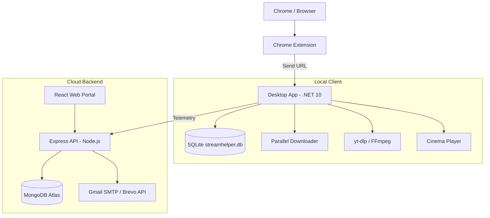

# SaveZonix

Windows desktop media downloader built with .NET 10, accompanied by a React web portal and an Express/MongoDB cloud API for user accounts and analytics.

---

## Deployments

| Component | Host | URL |
| :--- | :--- | :--- |
| **Web Portal** | Vercel | [https://save-zonix.vercel.app](https://save-zonix.vercel.app) |
| **Admin Dashboard** | Vercel | [https://save-zonix.vercel.app/admin/overview](https://save-zonix.vercel.app/admin/overview) |
| **Backend API** | Render | [https://savezonix.onrender.com](https://savezonix.onrender.com) |
| **Desktop Installer** | Windows x64 | Built with Inno Setup (`build-installer.bat`) |

---

## Architecture



---

## Repository Structure

```
SaveZonix/
├── build-installer.bat          # Inno Setup build script
├── README.md
│
├── SaveZonix-App/               # Desktop app (.NET 10 MVC / Win-x64)
│   ├── Controllers/             # MVC controllers (Home, Account, Cinema, Playlist)
│   ├── Core/                    # ParallelDownloader, M3U8Parser, FFmpeg runner
│   ├── Data/                    # AppDbContext (SQLite)
│   ├── Extension/               # Chrome Extension (Manifest V3)
│   ├── Models/                  # C# models
│   ├── Services/                # YouTube extraction, playlist queue, cloud sync
│   ├── Views/                   # Razor views
│   ├── wwwroot/                 # Desktop frontend (HTML, CSS, JS)
│   └── installer/               # Inno Setup config (.iss)
│
└── SaveZonix-Web/               # Web portal and API
    ├── client/                  # React + Vite frontend
    │   └── src/
    │       ├── components/      # UI components and Admin dashboard
    │       └── App.jsx
    └── server/                  # Node.js + Express backend
        ├── middleware/          # Rate limiting, disposable email blocker
        ├── models/              # User, OtpToken, EmailLog, DownloadHistory
        ├── routes/              # auth, admin, playlist, downloads, app-config
        └── services/            # emailService (Gmail SMTP + Brevo fallback)
```

---

## Features

### Desktop App (`SaveZonix-App`)
- **Parallel Chunk Downloader:** Splits downloads into multiple concurrent byte-range HTTP connections.
- **YouTube & Playlists:** Single video and batch playlist downloads with resolution selection up to 4K/8K and audio extraction.
- **HLS Stream Capture:** Records live `.m3u8` streams into `.mp4` files using bundled FFmpeg.
- **Embedded Player:** Built-in player for previewing completed downloads.
- **Local Storage:** Uses embedded SQLite (`streamhelper.db`) with WAL mode for local history.

### Web & API (`SaveZonix-Web`)
- **Dual-Channel OTP Delivery:** Sends 6-digit verification codes using Gmail SMTP as primary, with automatic failover to Brevo REST API (HTTPS port 443) if SMTP is blocked on cloud hosts.
- **OTP Security:** Codes are hashed with HMAC-SHA256 using a server pepper before saving to MongoDB. Expired tokens are purged automatically via a 10-minute TTL index.
- **Spam & Abuse Protection:** 60-second resend cooldown, 5-attempt brute-force lockout, disposable email domain blocking, and IP rate limiting.
- **1-Click Magic Link:** Verification emails include both a 6-digit code and a direct verification button.
- **6-Box OTP Input:** Auto-focus navigation, backspace handling, and clipboard paste support.
- **Admin Dashboard:** Overview of active downloads, user accounts, and email delivery telemetry (`/admin/*`).

### Chrome Extension
- Sniffs video and audio URLs on media pages.
- One-click action to pass URLs directly to the desktop app at `http://localhost:5000`.

---

## Getting Started

### Prerequisites
- Windows 10/11 (64-bit)
- [.NET 10.0 SDK](https://dotnet.microsoft.com/download)
- [Node.js 18+](https://nodejs.org/)
- MongoDB (local or Atlas)
- [Inno Setup 6](https://jrsoftware.org/isdl.php) (optional, for building the installer)

### 1. Run Desktop App
```powershell
cd SaveZonix-App
dotnet restore
dotnet run
```
Opens locally at `http://localhost:5000`.

### 2. Run Web Frontend
```powershell
cd SaveZonix-Web\client
npm install
npm run dev
```
Runs at `http://localhost:5173`.

### 3. Run Backend Server
```powershell
cd SaveZonix-Web\server
npm install
npm start
```
Runs at `http://localhost:5001`.

### 4. Build Windows Installer
Run the root build script:
```cmd
build-installer.bat
```
The output setup file is saved to `SaveZonix-App/installer/SaveZonix-Setup-v2.5.2.exe`.

---

## API Reference

### Cloud API (`SaveZonix-Web/server`)

| Method | Endpoint | Description | Auth |
| :--- | :--- | :--- | :--- |
| `POST` | `/api/auth/send-register-otp` | Sends registration OTP & magic link | Public |
| `POST` | `/api/auth/verify-register-otp` | Verifies registration OTP and creates user | Public |
| `POST` | `/api/auth/magic-verify` | Handles 1-click email magic link | Public |
| `POST` | `/api/auth/send-reset-otp` | Sends password reset OTP | Public |
| `POST` | `/api/auth/verify-reset-otp` | Verifies reset OTP and updates password | Public |
| `POST` | `/api/auth/login` | Email/password login, returns JWT | Public |
| `GET` | `/api/auth/me` | Current user profile | Bearer Token |
| `GET` | `/api/auth/telemetry/email-stats` | Email delivery stats (Gmail vs Brevo) | Admin |
| `GET` | `/api/app-config` | Client configuration for desktop apps | Public |
| `POST` | `/api/admin/record-download` | Records download metrics from desktop app | Public |
| `GET` | `/api/admin/stats` | System stats, active users, storage metrics | Admin |
| `GET` | `/api/admin/users` | User list and subscription tiers | Admin |

### Local Desktop API (`SaveZonix-App`)

| Method | Endpoint | Description |
| :--- | :--- | :--- |
| `POST` | `/api/analyze` | Extracts stream URLs and formats for a given link |
| `POST` | `/api/download` | Starts downloading a file or stream |
| `POST` | `/api/playlist/analyze` | Parses playlist items and metadata |
| `POST` | `/api/playlist/start-batch` | Starts batch download queue |
| `GET` | `/api/playlist/status` | Current progress of active playlist job |
| `POST` | `/api/playlist/cancel` | Cancels active batch job |
| `GET` | `/api/active-jobs` | Returns all active downloads |
| `GET` | `/api/system/health` | Health check and engine version |

---

## Environment Variables

Create `.env` inside `SaveZonix-Web/server/`:

```env
PORT=5001
MONGO_URI=mongodb+srv://<user>:<password>@cluster.mongodb.net/SaveZonixDb?retryWrites=true&w=majority
JWT_SECRET=your_jwt_secret_here

# Email Delivery (Gmail SMTP + Brevo Fallover)
SMTP_HOST=smtp.gmail.com
SMTP_PORT=587
SMTP_USER=your_email@gmail.com
SMTP_PASS=your_gmail_app_password
SMTP_FROM="SaveZonix <your_email@gmail.com>"
BREVO_API_KEY=xkeysib-your_brevo_api_key

# Security & Frontend
OTP_SECRET=your_hmac_secret_pepper
FRONTEND_URL=https://save-zonix.vercel.app
```

---

## Changelog

### v2.5.2
- **Email OTP Suite:** Added dual-channel dispatch (Gmail SMTP with Brevo HTTP API failover), HMAC-SHA256 token hashing, 10-minute MongoDB TTL persistence, and abuse limits (60s cooldown, 5-attempt lockout, disposable email filter).
- **Verification UI:** Added 6-box auto-focus OTP input with clipboard paste support and 1-click magic link handler.
- **Database Simplification:** Migrated local storage from SQL Server to embedded SQLite (`streamhelper.db`) with WAL mode.
- **Admin Decoupling:** Moved administrative features to the web cloud portal; desktop app now functions as a clean client reporting telemetry via API.
- **FFmpeg Resolution:** Improved fallback detection for bundled FFmpeg binaries across multiple directory paths.

---

## License

Proprietary. All rights reserved.  
Copyright (c) 2026 SaveZonix Inc.
